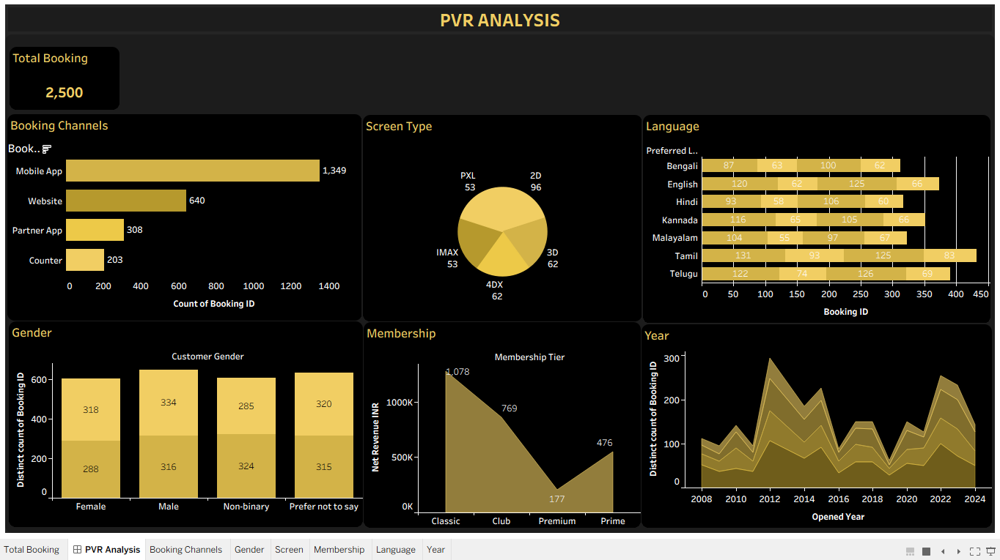
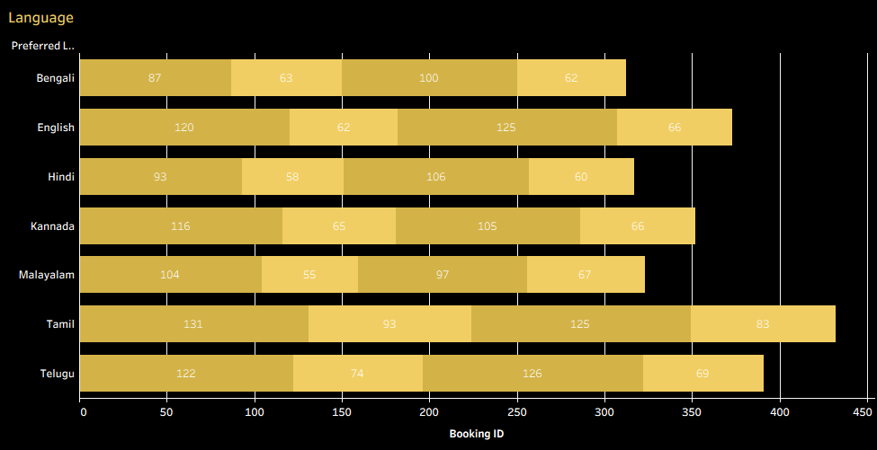
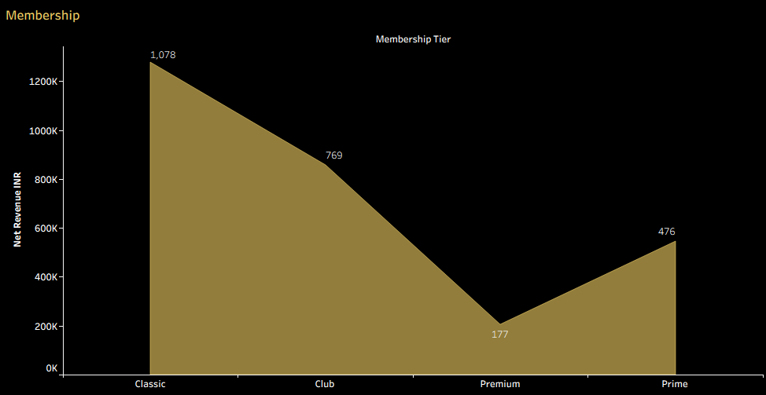

# 🎬 PVR Movie Booking Analytics

### Interactive Tableau Dashboard | Data Analytics Portfolio Project

[](https://www.tableau.com/)
[](https://www.microsoft.com/en-us/microsoft-365/excel)
[](https://github.com/)

## 📌 Project Overview

PVR Movie Booking Analytics is an interactive data analytics project built to explore movie bookings, ticket sales, revenue performance, customer preferences, cinema operations, and showtime utilization.

The project uses a synthetic movie booking dataset to demonstrate how data can be transformed into meaningful business insights through Tableau dashboards and data visualization.

The goal is to analyze booking patterns, compare performance across business dimensions, and present findings that can support data-driven decision-making.

> **Disclaimer:** This project uses synthetic/demo data for practice and portfolio purposes. It is not official PVR Cinemas data and does not represent actual company performance.

## 🎯 Business Objectives

- Analyze total bookings and ticket sales.
- Understand movie and genre performance.
- Evaluate revenue and payment trends.
- Compare cinema and city performance.
- Explore customer demographics and membership patterns.
- Analyze showtime occupancy and seat utilization.
- Identify booking trends over time.
- Build interactive dashboards for business reporting.

## 🛠️ Tools and Technologies

| Tool | Purpose |
|---|---|
| Tableau Desktop | Dashboard creation and data visualization |
| Tableau Public | Publishing and sharing interactive dashboards |
| Microsoft Excel | Dataset storage and inspection |
| GitHub | Project documentation and version control |

## 📂 Dataset Description

The project uses `PVR_Movie_Booking_Dataset.xlsx`, an Excel workbook containing 10 worksheets.

| Worksheet | Records | Description |
|---|---:|---|
| Bookings | 2,500 | Booking details, amounts, discounts, and booking status |
| Movies | 30 | Movie titles, genres, languages, and attributes |
| Customers | 1,800 | Customer and membership information |
| Cinemas | 50 | Cinema locations and facilities |
| Screens | 326 | Screen capacity and technical details |
| Showtimes | 5,200 | Movie schedules, ticket prices, and occupancy |
| Payments | 2,500 | Payment transactions and statuses |
| Tickets | 6,804 | Individual ticket and seat information |
| Read_Me | — | Dataset instructions and usage notes |
| Data_Dictionary | — | Table and column definitions |

The workbook contains synthetic booking and show data spanning **January 1, 2026, to October 20, 2026**. Monetary values are represented in Indian rupees (INR).

## 📊 Dashboard Pages

The following pages form the planned dashboard structure. Adjust the descriptions to match the pages implemented in your workbook.

### 1. Executive Overview
Provides a high-level view of booking activity, ticket sales, revenue, and overall performance using KPI cards and summary charts.

### 2. Movie Performance
Explores movie-level booking activity, ticket sales, and revenue to identify high-performing titles.

### 3. Cinema and City Analysis
Compares booking and revenue performance across cinema locations and cities.

### 4. Revenue and Payments
Analyzes revenue, refunds, payment methods, and transaction status.

### 5. Customer Insights
Explores customer segments, membership tiers, and booking preferences where supported by the data.

### 6. Show and Seat Utilization
Examines showtime occupancy, seat utilization, and demand patterns.

## 📈 Key Performance Indicators

Potential KPIs include:

- **Total Bookings:** Distinct count of booking IDs.
- **Total Tickets Sold:** Count of ticket IDs, with appropriate handling of ticket status.
- **Gross Booking Amount:** Total customer bill before refunds.
- **Net Revenue:** Booking amount after applicable refunds.
- **Average Booking Value:** Total booking amount divided by distinct bookings.
- **Cancellation Rate:** Cancelled bookings divided by distinct bookings.
- **Average Ticket Price:** Gross ticket amount divided by seat count.

Use the definitions in the workbook's `Data_Dictionary` and verify the calculations before displaying them in the final dashboard.

## 🔍 Key Business Insights

Document your findings after exploring the actual dashboard results.

Examples of questions to investigate:

- Which movies generate the highest revenue?
- Which genres attract the most bookings?
- Which cities or cinemas have stronger booking performance?
- How does booking activity change over time?
- Which payment methods are most frequently used?
- Which shows have higher occupancy?
- What proportion of bookings are cancelled or refunded?

Add three to five verified findings with actual values and a brief explanation of their business implications.

## 🖼️ Dashboard Preview

### Executive Overview



### Movie Performance Analysis



### Cinema and City Analysis



*Replace these image paths with the screenshots you actually save in the `screenshots/` folder.*

## 🌐 Live Interactive Dashboard

The live link will be added after the workbook is published to Tableau Public.

## 📁 Repository Structure

```text
PVR-Movie-Booking-Analytics/
│
├── README.md
│
├── data/
│   ├── README.md
│   └── PVR_Movie_Booking_Dataset.xlsx
│
├── workbook/
│   └── PVR_Movie_Booking_Analytics.twb
│
└── screenshots/
    ├── overview.png
    ├── movie-performance.png
    └── cinema-analysis.png
```

## 🔗 Data Relationships

The dataset contains multiple related tables. Use Tableau relationships where appropriate:

- `Bookings.Customer_ID` → `Customers.Customer_ID`
- `Bookings.Movie_ID` → `Movies.Movie_ID`
- `Bookings.Cinema_ID` → `Cinemas.Cinema_ID`
- `Bookings.Screen_ID` → `Screens.Screen_ID`
- `Bookings.Show_ID` → `Showtimes.Show_ID`
- `Payments.Booking_ID` → `Bookings.Booking_ID`
- `Tickets.Booking_ID` → `Bookings.Booking_ID`
- `Screens.Cinema_ID` → `Cinemas.Cinema_ID`

## 🚀 How to Explore the Project

1. Download or clone this repository.
2. Open the Tableau workbook in Tableau Desktop.
3. Reconnect the Excel data source if necessary.
4. Review the dashboard pages and interactive filters.
5. Explore booking, revenue, movie, customer, and cinema trends.
6. Review the dataset documentation to understand field definitions.
7. Visit the Tableau Public link once it is available.

## 💼 Skills Demonstrated

- Data visualization and dashboard development
- KPI design and business reporting
- Exploratory data analysis
- Data relationships and aggregation
- Revenue and booking analysis
- Interactive dashboard design
- Data storytelling
- Business problem-solving

## 👨‍💻 About the Project

This project is part of my Data Analytics portfolio and demonstrates my ability to organize data, build interactive visualizations, analyze business metrics, and communicate insights through dashboards.


---

*Created as a data analytics practice project using synthetic/demo data.*
